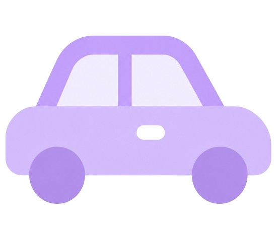
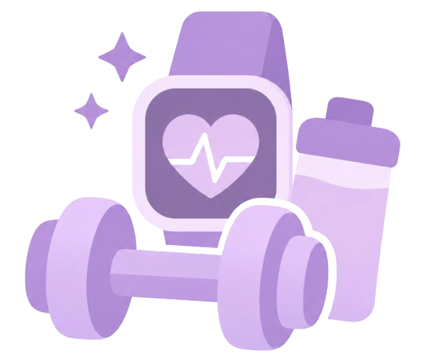

<table align="center" border="0">
  <tr>
    <td align="center" valign="middle">
      <h2>☾ Welcome to the Samisphere</h2>
    </td>
    <td align="center" valign="middle">
      
    </td>
  </tr>
</table>

  
   
 

## Hi! I'm **Samia** 

Computer Science Engineering graduate specializing in **AI, Full-Stack Development, and UI/UX Design**.

This is my little corner to share projects, explore ideas, and keep learning. I'm currently building projects to strengthen my skills and grow as a developer. 🌱

  ────────────── ୨୧ ──────────────

## ⌘ Tech Stack

> ### ✧ Programming Languages
>
> <table width="100%">
>   <tr>
>     <td align="center"></td>
>     <td align="center"></td>
>     <td align="center"></td>
>     <td align="center"></td>
>     <td align="center"></td>
>   </tr>
>   <tr>
>     <td align="center">Python</td>
>     <td align="center">Java</td>
>     <td align="center">JavaScript</td>
>     <td align="center">C++</td>
>     <td align="center">C</td>
>   </tr>
> </table>

> ### ୨୧ Libraries & Frameworks
>
> <table width="100%">
>   <tr>
>     <td align="center"></td>
>     <td align="center"></td>
>     <td align="center"></td>
>     <td align="center"></td>
>     <td align="center"></td>
>     <td align="center"></td>
>   </tr>
>   <tr>
>     <td align="center">HTML</td>
>     <td align="center">CSS</td>
>     <td align="center">React</td>
>     <td align="center">Node.js</td>
>     <td align="center">Express</td>
>     <td align="center">Flutter</td>
>   </tr>
> </table>

> ### ☁ AI & Data Science
>
> <table width="100%">
>   <tr>
>     <td align="center"></td>
>     <td align="center"></td>
>     <td align="center"></td>
>     <td align="center"></td>
>     <td align="center"></td>
>   </tr>
>   <tr>
>     <td align="center">TensorFlow</td>
>     <td align="center">PyTorch</td>
>     <td align="center">OpenCV</td>
>     <td align="center">MySQL</td>
>     <td align="center">Oracle</td>
>   </tr>
> </table>

> ### ♡ Tools & Platforms
>
> <table width="100%">
>   <tr>
>     <td align="center"></td>
>     <td align="center"></td>
>     <td align="center"></td>
>     <td align="center"></td>
>     <td align="center"></td>
>   </tr>
>   <tr>
>     <td align="center">Git</td>
>     <td align="center">GitHub</td>
>     <td align="center">Figma</td>
>     <td align="center">VS Code</td>
>     <td align="center">Linux</td>
>   </tr>
> </table>

  ────────────── ୨୧ ──────────────

## ✳ My GitHub Contributions

  

  ────────────── ୨୧ ──────────────

## ✧ Featured Projects

<table>
  <tr>
    <td width="100" align="center" valign="middle">
      
    </td>
    <td valign="middle">
      <b>Car Plate Detection</b> 
      AI-powered license plate recognition using OpenCV, OCR, and Deep Learning.
    </td>
  </tr>

  <tr>
    <td width="100" align="center" valign="middle">
      
    </td>
    <td valign="middle">
      <b>Basair</b> 
      A modern, accessible Quran learning mobile application designed for intuitive study.
    </td>
  </tr>

  <tr>
    <td width="100" align="center" valign="middle">
      
    </td>
    <td valign="middle">
      <b>AI Fitness Tracker</b> 
      A full-stack application for tracking workouts and supporting fitness goals.
    </td>
  </tr>
</table>

  ────────────── ୨୧ ──────────────

## ↗ Let's Connect

  
  
  

☾ Thanks for stopping by the <b>Samisphere</b>. 

